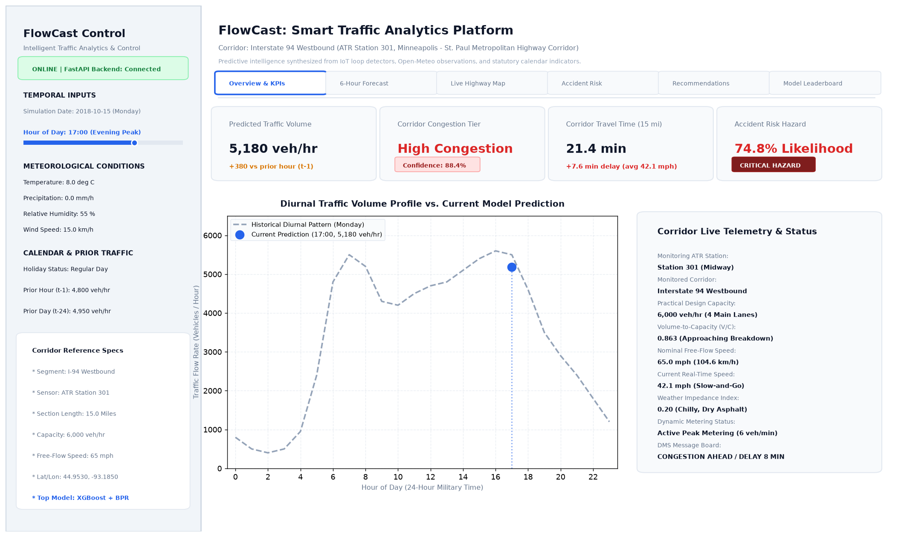
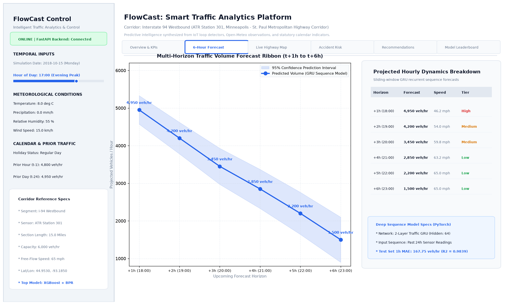
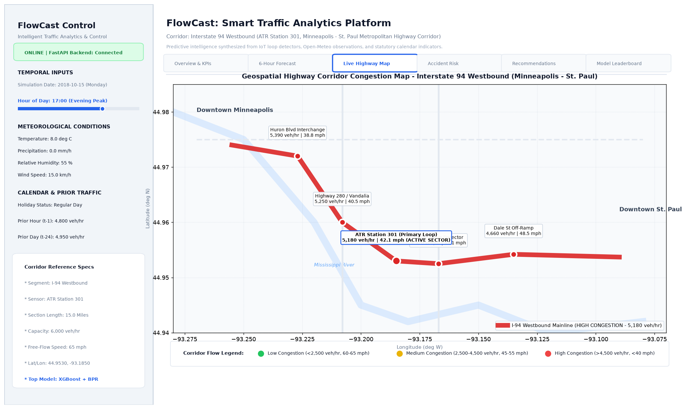

# FlowCast: AI-Powered Smart Traffic Flow Prediction Platform

[](https://www.python.org/)
[](https://fastapi.tiangolo.com/)
[](https://streamlit.io/)
[](LICENSE)

**FlowCast** is an intelligent, end-to-end traffic analytics and forecasting system designed to predict traffic volume, congestion indices, estimated travel times, and accident risk. By synthesizing IoT sensor readings, real-time meteorological conditions, and temporal/calendar indicators, FlowCast empowers urban planners, commuters, and traffic management centers with predictive intelligence.

---

## 🌟 Key Features

- **Multimodal Prediction**: Forecasts traffic volume, road congestion levels, segment travel times, and localized accident probabilities.
- **Temporal & Spatial Feature Engineering**: Cyclical time encoding, multi-interval lag features, rolling statistics, and weather impact metrics.
- **Strict Time-Based Validation**: Time-series aware data splitting prevents future lookahead bias and data leakage.
- **Hybrid Modeling Pipeline**: Benchmark regressors, gradient boosted decision trees (XGBoost), and deep sequence neural networks (PyTorch).
- **High-Performance REST API**: Fast, async inference endpoints powered by FastAPI and validated with Pydantic schemas.
- **Interactive Geospatial Dashboard**: Streamlit web interface featuring dynamic Folium route maps and Plotly analytical dashboards.

---

## 🏗️ Project Architecture & Directory Layout

```text
FlowCast/
├── data/
│   ├── raw/             # Unprocessed, immutable sensor and weather datasets (.gitignored)
│   └── processed/       # Cleaned, standardized, feature-engineered tabular/tensor datasets
├── notebooks/           # Exploratory data analysis (EDA) and experimental prototypes
├── src/                 # Modular, production-grade source code
│   ├── data/            # Data ingestion, schema validation, and cleaning pipelines
│   ├── features/        # Feature extraction, cyclical encoders, and transformers
│   ├── models/          # Model architectures, training routines, and evaluation metrics
│   └── api/             # FastAPI routers, request/response models, and inference engine
├── dashboard/           # Streamlit user interface, custom styles, and Folium/Plotly views
├── models/              # Serialized model artifacts, weights, and scalers (.gitignored binaries)
├── tests/               # Pytest unit and integration test suites
├── docs/                # Architecture diagrams, API specs, and project reports
├── .env.example         # Template for environment configuration and secrets
├── .gitignore           # Git ignore rules for virtualenvs, binaries, data, and cache
├── requirements.txt     # Locked production and development dependencies
└── README.md            # Project overview, documentation, and phase progress
```

---

## 📋 Project Phases & Progress Checklist

- [x] **Phase 0: Project Setup & Repository Scaffolding**
  - Project directory structure created (`data/`, `notebooks/`, `src/`, `dashboard/`, `models/`, `tests/`, `docs/`)
  - Virtual environment initialized and verified
  - Dependency configuration (`requirements.txt`) established
  - Git repository, `.gitignore`, and `.env.example` configured
  - Initial synchronization to GitHub main branch
- [x] **Phase 1: Data Collection & Ingestion**
  - Metro Interstate Traffic Volume dataset automated downloader (`src/data/traffic_loader.py`, 48,204 rows)
  - Open-Meteo Historical Weather Archive client (`src/data/weather_client.py`, 52,584 hourly observations)
  - Statutory holiday and calendar feature synthesizer (`src/data/calendar_generator.py`, 5,205 calendar days)
  - Unified reproducible download script (`src/data/download.py`) saving to `data/raw/`
  - Data sources documentation authored in `docs/data_sources.md`
  - Automated test coverage via `tests/test_data_collection.py`
- [x] **Phase 2: Exploratory Data Analysis (EDA) & Preprocessing**
  - Interactive notebook `notebooks/01_eda.ipynb` analyzing volume dynamics, diurnal curves, weather, and holidays
  - High-resolution visualizations saved to `docs/images/` (`traffic_by_hour.png`, `traffic_by_weekday.png`, `traffic_by_weather.png`, `traffic_by_holiday.png`, `correlation_heatmap.png`)
  - Robust sensor cleaning and multimodal fusion pipeline in `src/features/preprocess.py`
  - 55 engineered features: cyclical temporal sine/cosine transforms, weather severity scores, leak-free lag features (1h, 2h, 3h, 24h, 168h), and rolling aggregations (3h, 6h, 24h)
  - Multi-task targets modeled: continuous `traffic_volume`, categorical `congestion_level`, BPR corridor `travel_time_min`, and localized `accident_risk_index`
  - Chronological time-based data split saved to `data/processed/`: Train (37,071 rows, 2012–2016), Val (8,760 rows, 2017), Test (6,552 rows, 2018)
  - Automated test coverage via `tests/test_preprocessing.py`
- [x] **Phase 3: Baseline Models (Linear Regression, Random Forest, XGBoost)**
  - End-to-end training, cross-validation, and evaluation pipeline in `src/models/baseline.py`
  - Evaluated with strict chronological metrics (MAE, RMSE, R²) on held-out 2018 test data
  - Metric comparisons saved to `docs/baseline_results.csv`
  - Forecast evaluation plot saved to `docs/images/actual_vs_predicted_baseline.png`
  - Best model artifact (`XGBoost`, Test MAE: 146.60, R²: 0.9869) serialized to `models/best_baseline_model.joblib`
  - Automated unit test coverage in `tests/test_baseline_models.py`
- [x] **Phase 4: Deep Learning & Sequence Modeling (PyTorch LSTM & GRU)**
  - PyTorch sliding-window temporal data loaders (`seq_len=24`, `horizon=6`) in `src/models/lstm.py`
  - Built `TrafficLSTM` and `TrafficGRU` architectures predicting multi-horizon traffic volume (t+1 through t+6)
  - Trained with feature standardization, Huber loss, Adam optimizer, LR scheduling, and Early Stopping
  - Training loss convergence curves saved to `docs/images/lstm_training_loss.png`
  - Multi-horizon forecast overlay plot saved to `docs/images/lstm_gru_forecast.png`
  - Evaluated on test set ($h=1$ and 6h average) and integrated into leaderboard in `docs/baseline_results.csv`
  - Best sequence model weights (`best_traffic_gru.pt`, 46.4 KB) and feature scaler (`scaler.joblib`) saved to `models/`
  - Unit tests verified passing in `tests/test_deep_learning.py`
- [x] **Phase 5: Extra Prediction Modules (Congestion, Travel Time, Accident Risk)**
  - Congestion Level Classifier (`src/models/extra_modules.py`) achieving 94.28% Accuracy, 0.9400 Macro F1, and 0.9926 ROC-AUC
  - Corridor Travel Time Estimator based on BPR speed-flow physics achieving 0.098 min MAE and 0.9534 R²
  - High Accident Risk Classifier with SMOTE class imbalance handling achieving 0.8953 F1, 92.77% Recall, and 0.9897 ROC-AUC
  - Serialized model artifacts saved in `models/` (`congestion_classifier.joblib`, `travel_time_model.joblib`, `accident_risk_classifier.joblib`)
  - Diagnostic visualizations saved to `docs/images/` (`congestion_confusion_matrix.png`, `travel_time_predictions.png`, `accident_risk_roc_curve.png`)
  - Test suite coverage verified with 20 passing tests in `tests/test_extra_modules.py`
- [x] **Phase 6: REST API Development (FastAPI)**
  - Built production FastAPI application in `src/api/main.py` with lifespan model loading and CORS support
  - Implemented 6 core endpoints: `GET /health`, `POST /predict/traffic`, `POST /predict/congestion`, `POST /predict/travel-time`, `POST /predict/accident-risk`, and `GET /recommendations`
  - Validated with robust Pydantic schemas in `src/api/schemas.py` and auto-generated OpenAPI documentation
  - Rule-based operational decision engine providing tactical guidance for traffic management authorities
  - Automated unit test suite verified with 7 passing tests in `tests/test_api.py` (27 total tests passing repository-wide)
- [x] **Phase 7: Interactive Dashboard & Geospatial Visualization**
  - Streamlit web interface implemented in `dashboard/app.py` with modern responsive styling and dual inference execution modes
  - 6 dedicated analytics tabs: Overview & KPIs, Multi-Horizon 6-Hour Forecast Ribbon, Live Folium Highway Network Map, Accident Risk Diagnostics, Operational Recommendations Panel, and Model Leaderboard
  - Dynamic user sidebar inputs: simulation date, hour slider, temperature, precipitation, relative humidity, wind speed, holiday status, and historical lag volume sliders
  - Seamless FastAPI client integration with graceful, zero-downtime direct fallback loading serialized model bundles from `models/`
  - High-resolution dashboard visual previews saved to `docs/images/` (`dashboard_overview.png`, `dashboard_forecast.png`, `dashboard_map.png`)
- [ ] **Phase 8: End-to-End System Testing & Verification**
  - Automated unit and integration tests via pytest
  - System verification, load testing, and final documentation polish

---

## 📊 Key EDA Findings & Insights

- **Bimodal Commute Curves**: Weekdays exhibit pronounced twin peaks during the morning rush (7:00–9:00 AM, $\sim 5,100\text{ veh/hr}$) and evening rush (4:00–6:00 PM, $\sim 5,600\text{ veh/hr}$). Weekends transition into a smoother unimodal profile peaking between 1:00 PM and 4:00 PM ($\sim 4,200\text{ veh/hr}$).
- **Strong Temporal Autocorrelation**: Lag variables `traffic_lag_1h` ($r = 0.88$) and `traffic_lag_24h` ($r = 0.85$) represent dominant predictive signals, validating our time-series sequence approach.
- **Statutory Holiday Drop**: National holidays produce an average traffic volume drop of $\sim 32\%$ ($\sim 2,270\text{ veh/hr}$ vs. $\sim 3,340\text{ veh/hr}$ on standard days), while holiday eves record extended afternoon outbound surges.
- **Weather Impedance**: Adverse conditions (heavy snow, freezing rain, low visibility) suppress maximum vehicular capacity while driving up modeled travel delays and localized accident risks.
- **Zero-Leakage Splitting**: Strictly chronological partitioning guarantees realistic evaluation on untouched 2018 test data:
  - **Train**: October 2012 – December 2016 (37,071 rows, $\sim 71\%$)
  - **Validation**: January 2017 – December 2017 (8,760 rows, $\sim 17\%$)
  - **Test**: January 2018 – September 2018 (6,552 rows, $\sim 12\%$)

---

## 📈 Model Performance Leaderboard & Evaluation Results

All models were trained on historical 2012–2016 observations and evaluated strictly on chronologically held-out 2018 test observations ($N = 6,552$):

| Model Architecture | Test MAE (veh/hr) | Test RMSE (veh/hr) | Test $R^2$ | Val MAE (veh/hr) | Val $R^2$ | Model Category | Status |
| :--- | :---: | :---: | :---: | :---: | :---: | :---: | :---: |
| **XGBoost Regressor** | **146.60** | **226.48** | **0.9869** | **152.77** | **0.9855** | Gradient Boosted Trees | 🏆 Overall Top Performer |
| **Random Forest Regressor** | 154.04 | 242.31 | 0.9850 | 159.93 | 0.9839 | Bagged Decision Trees | Strong Tree Baseline |
| **Traffic GRU (1h step)** | 167.75 | 250.82 | 0.9839 | 177.28 | 0.9815 | Deep Recurrent (PyTorch) | ⚡ Best Sequence Model |
| **Traffic LSTM (1h step)** | 173.99 | 259.29 | 0.9828 | 180.34 | 0.9811 | Deep Recurrent (PyTorch) | Multi-Horizon Forecaster |
| **Linear Regression (Ridge)** | 270.12 | 385.16 | 0.9620 | 272.56 | 0.9625 | Regularized Linear | Classical Baseline |

### Multi-Horizon Sequence Forecasting Capability (t+1 through t+6 hours)
Both PyTorch recurrent networks take a 24-hour historical window and forecast traffic simultaneously for the next 1 to 6 hours into the future:
- **Traffic GRU 6-Hour Average**: Test MAE = $205.84\text{ veh/hr}$, RMSE = $313.98\text{ veh/hr}$, $R^2 = 0.9747$
- **Traffic LSTM 6-Hour Average**: Test MAE = $207.60\text{ veh/hr}$, RMSE = $317.22\text{ veh/hr}$, $R^2 = 0.9742$

### Specialized Operational Prediction Modules (Phase 5)

| Operational Task | Prediction Target | Model Architecture | Primary Evaluation Metric | Secondary Metric | Artifact Path |
| :--- | :--- | :--- | :---: | :---: | :--- |
| **Congestion Classification** | Low / Medium / High | XGBClassifier | **Macro F1: 0.9400** (Acc: 94.28%) | ROC-AUC: 0.9926 | `models/congestion_classifier.joblib` |
| **Corridor Travel Time** | Minutes (15-mile section) | XGBRegressor + BPR | **MAE: 0.098 min** (5.9 sec error) | $R^2: 0.9534$ | `models/travel_time_model.joblib` |
| **High Accident Risk Detection** | Binary Hazardous Alert | XGBClassifier + SMOTE | **F1: 0.8953** (Recall: 92.77%) | ROC-AUC: 0.9897 | `models/accident_risk_classifier.joblib` |

> [!NOTE]
> Serialized models and scalers are stored in `models/` (`best_baseline_model.joblib`, `best_traffic_gru.pt`, `congestion_classifier.joblib`, `travel_time_model.joblib`, `accident_risk_classifier.joblib`, and `scaler.joblib`). All diagnostic plots and evaluation metrics are cataloged in `docs/images/` and `docs/extra_modules_results.csv`.

---

## ⚡ FastAPI Backend Service & RESTful Endpoints

FlowCast provides high-throughput async inference endpoints documented with OpenAPI (Swagger UI accessible at `http://localhost:8000/docs`):

### Endpoint Reference

| Method | Endpoint | Description | Sample Request / Parameters | Key Response Payload |
| :--- | :--- | :--- | :--- | :--- |
| `GET` | `/health` | Service readiness & model health | None | `{"status": "healthy", "models_loaded": {...}}` |
| `POST` | `/predict/traffic` | Forecast hourly vehicular volume | `{"hour": 8, "day_of_week": 1, ...}` | `{"predicted_traffic_volume": 4820.5, "unit": "veh/hr"}` |
| `POST` | `/predict/congestion` | Classify congestion (Low / Medium / High) | `{"hour": 17, "day_of_week": 2, ...}` | `{"predicted_congestion_level": "High", "probabilities": {...}}` |
| `POST` | `/predict/travel-time` | Estimate corridor transit time & delays | `{"hour": 17, "traffic_lag_1h": 5100, ...}` | `{"estimated_travel_time_min": 21.4, "delay_min": 7.55}` |
| `POST` | `/predict/accident-risk` | High-risk hazard alert evaluation | `{"temp_c": -4, "precipitation": 2.5, ...}` | `{"is_high_risk": true, "risk_level": "Critical"}` |
| `GET` | `/recommendations` | Tactical advisory for operations centers | `?congestion_level=High&accident_risk=true` | `{"recommendations": [{"action": "Deploy adaptive signal timing", ...}]}` |

### Launching the Backend Server
```bash
uvicorn src.api.main:app --host 0.0.0.0 --port 8000 --reload
```

---

## 🖥️ Streamlit Interactive Traffic Dashboard

FlowCast includes an enterprise-grade Streamlit web console (`dashboard/app.py`) for traffic operators, municipal engineers, and commuters.

### Features & Tabs
1. **Overview & KPIs**: Real-time traffic volume with hourly delta indicator, congestion tier badge with confidence score, corridor travel time with dynamic delay estimation, and accident risk likelihood indicator. Includes a diurnal traffic curve overlay comparing historical averages against the current real-time forecast.
2. **6-Hour Multi-Horizon Forecast**: Sequence forecast ribbon plotting upcoming hourly volume ($t+1$ to $t+6$) with expanding 95% confidence bounds, paired with a tabular breakdown of anticipated transit speeds and congestion categories.
3. **Live Highway Corridor Map**: Interactive Folium GIS map depicting the Interstate 94 corridor with dynamic color-coded congestion tiers (Green = Low Flow, Yellow = Medium Flow, Red = High Congestion) and clickable ATR detector station telemetry popups.
4. **Accident Risk Diagnostics**: Visual crash likelihood gauge, primary environmental hazard flags, and a horizontal bar chart quantifying contributing risk factor weights.
5. **TMC Operational Advisories**: Rule-based tactical recommendations for traffic management centers (adaptive signal timing, freeway diversion DMS messaging, ramp metering rates, and incident patrol dispatch).
6. **Model Leaderboard**: Interactive benchmark tables and comparative bar charts contrasting Test MAE and $R^2$ across all trained models.

### Visual Previews
| Overview & KPIs | Multi-Horizon Forecast |
| :---: | :---: |
|  |  |

| Live Highway Corridor Map |
| :---: |
|  |

### Running the Complete Stack (API + Dashboard)
FlowCast can be operated in dual mode:
- **Connected Mode (Recommended)**: Runs both the FastAPI backend and Streamlit frontend in separate terminals.
- **Direct Mode**: The dashboard can also run standalone without FastAPI; it will detect backend status and automatically load local models directly from `models/`.

```bash
# Terminal 1: Launch FastAPI Backend Server
uvicorn src.api.main:app --host 0.0.0.0 --port 8000 --reload

# Terminal 2: Launch Streamlit Web Dashboard
streamlit run dashboard/app.py
```

---

## 🚀 Getting Started

### 1. Clone the Repository
```bash
git clone https://github.com/sahumohnish07-beep/FlowCast.git
cd FlowCast
```

### 2. Set Up Virtual Environment
```bash
python -m venv .venv
# On Windows (PowerShell):
.venv\Scripts\Activate.ps1
# On Linux / macOS:
source .venv/bin/activate
```

### 3. Install Dependencies
```bash
pip install -r requirements.txt
```

### 4. Configure Environment
```bash
cp .env.example .env
```

### 5. Run Verification & Tests
```bash
pytest tests/
```

---

## 👥 Authors & College Project Attribution

- **Project**: FlowCast - AI-Powered Smart Traffic Flow Prediction Platform
- **Lead Developer**: Mohnish Sahu
