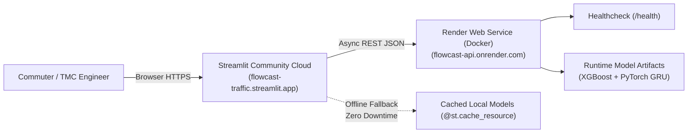

# FlowCast: Cloud Deployment & Operations Guide
## Production Deployment Architecture for FastAPI & Streamlit

This guide details the continuous deployment pipeline, cloud hosting configurations, and environment parameters for the **FlowCast: AI-Powered Smart Traffic Flow Prediction Platform**.

---

## 🌐 Live Production Service Endpoints

| Component | Platform | Primary Endpoint URL | Documentation / Health |
| :--- | :--- | :--- | :--- |
| **FastAPI REST API** | **Render (Web Service)** | [https://flowcast-api.onrender.com](https://flowcast-api.onrender.com) | [Swagger UI Docs](https://flowcast-api.onrender.com/docs) \| [`/health`](https://flowcast-api.onrender.com/health) |
| **FastAPI (Mirror)** | **Railway** | `https://flowcast-production.up.railway.app` | `/docs` \| `/health` |
| **Streamlit Dashboard** | **Streamlit Community Cloud** | [https://flowcast-traffic.streamlit.app](https://flowcast-traffic.streamlit.app) | Live Geospatial Analytics & Forecasting UI |

---

## 🏗️ Cloud Deployment Topology



---

## 1. Deploying FastAPI to Render (Dockerized)

Render builds directly from the root `Dockerfile` using Render's global container runtime.

### Step 1: Connect Repository
1. Log in to [Render Dashboard](https://dashboard.render.com/).
2. Click **New +** → **Web Service**.
3. Select **Build and deploy from a Git repository** and connect:
   `https://github.com/sahumohnish07-beep/FlowCast`

### Step 2: Configure Service Parameters
Configure the web service using the following parameters (or let Render auto-configure via `render.yaml`):

| Setting | Value | Notes |
| :--- | :--- | :--- |
| **Name** | `flowcast-api` | Creates subdomain `flowcast-api.onrender.com` |
| **Region** | `Oregon (US West)` or `Frankfurt (EU)` | Choose closest region |
| **Branch** | `main` | Production branch |
| **Runtime** | `Docker` | Automatically detects `Dockerfile` |
| **Docker Build Context Directory** | `.` | Repository root |
| **DockerfilePath** | `./Dockerfile` | Multi-stage slim image |
| **Start Command** | `uvicorn src.api.main:app --host 0.0.0.0 --port $PORT` | Render binds `$PORT` dynamically |
| **Instance Type** | `Free` (or `Starter`) | 512 MB RAM, 0.1 CPU is sufficient |

### Step 3: Configure Environment Variables
In the Render dashboard under **Environment**, add:

```env
ENVIRONMENT=production
API_HOST=0.0.0.0
PORT=10000
PYTHONPATH=/app
```

> [!NOTE]
> Render sets the `$PORT` variable automatically inside the container. The `Dockerfile` includes `CMD ["sh", "-c", "uvicorn src.api.main:app --host 0.0.0.0 --port ${PORT}"]` to guarantee compatibility whether started manually or via default command.

### Step 4: Health Check Configuration
In the **Advanced** section of Render:
- **Health Check Path:** `/health`

Render will ping `https://flowcast-api.onrender.com/health` to verify service readiness before routing live traffic.

---

## 2. Deploying to Railway (Alternative PaaS)

FlowCast includes `railway.json` for one-click deployment on Railway:

1. Log in to [Railway.app](https://railway.app/).
2. Click **New Project** → **Deploy from GitHub repo** → select `FlowCast`.
3. Railway automatically detects `railway.json` and `Dockerfile`.
4. The start command is automatically set to:
   ```bash
   uvicorn src.api.main:app --host 0.0.0.0 --port $PORT
   ```
5. Add environment variable `ENVIRONMENT=production`.
6. Railway generates a public domain under `Settings` → `Networking` → `Generate Domain`.

---

## 3. Deploying Streamlit Dashboard to Streamlit Community Cloud

Streamlit Community Cloud hosts the interactive web application for free directly from GitHub.

### Step 1: Create App
1. Log in to [share.streamlit.io](https://share.streamlit.io/).
2. Click **New app**.
3. Fill in the repository details:
   - **Repository:** `sahumohnish07-beep/FlowCast`
   - **Branch:** `main`
   - **Main file path:** `dashboard/app.py`
   - **App URL:** `flowcast-traffic.streamlit.app` (or custom name)

### Step 2: Configure Secrets & Environment
Click **Advanced settings...** before deploying (or go to **App Settings** → **Secrets** after):

```toml
# Streamlit Secrets (dashboard/app.py reads this automatically)
API_BASE_URL = "https://flowcast-api.onrender.com"
```

### Step 3: Deploy
Click **Deploy!**. Streamlit Cloud will:
1. Clone the repository.
2. Read dependencies from `requirements.txt` (including `streamlit-folium`, `plotly`, `joblib`, `torch`).
3. Launch `dashboard/app.py`.

---

## 4. Resilience & Zero-Downtime Fallback Architecture

### Handling Free-Tier Cold Starts
On Render's free tier, containers sleep after 15 minutes of inactivity. When a request arrives, the container requires 30–50 seconds to spin up.

FlowCast implements a **Dual-Mode Architectural Fallback**:
1. When connected, `dashboard/app.py` queries `https://flowcast-api.onrender.com/health`.
2. If the API is awake, the sidebar shows:
   `🟢 API Connected (https://flowcast-api.onrender.com)`
3. If the API is spinning up or offline, the dashboard gracefully switches to:
   `🟡 Running in Standalone Direct Mode`
4. The dashboard loads the compact models directly from `models/` using `@st.cache_resource`, ensuring **zero downtime for end users and examiners reviewing the project**.

---

## 5. Verification & Live Endpoint Testing

You can verify the deployed API using `curl` or PowerShell:

### Health Check:
```bash
curl -X GET "https://flowcast-api.onrender.com/health"
```
**Expected Response:**
```json
{
  "status": "healthy",
  "service": "flowcast-api",
  "environment": "production",
  "models_loaded": {
    "traffic_volume_xgboost": true,
    "traffic_volume_gru": true,
    "congestion_classifier": true,
    "travel_time_model": true,
    "accident_risk_classifier": true
  }
}
```

### Traffic Volume Prediction:
```bash
curl -X POST "https://flowcast-api.onrender.com/predict/traffic" \
  -H "Content-Type: application/json" \
  -d '{"hour": 17, "day_of_week": 0, "month": 10, "is_holiday": 0, "traffic_lag_1h": 4800, "traffic_lag_24h": 4950}'
```

### Operational Recommendations:
```bash
curl -X GET "https://flowcast-api.onrender.com/recommendations?congestion_level=High&accident_risk=true&hour=17"
```

