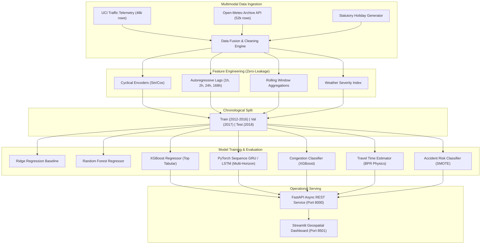

# FlowCast: AI-Powered Smart Traffic Flow Prediction Platform
## Comprehensive Technical Project Report & Academic Submission

**Project Title:** FlowCast: AI-Powered Smart Traffic Flow Prediction Platform  
**Author:** Mohnish Sahu  
**Course/Context:** Senior Undergraduate Capstone Project in Computer Science & Artificial Intelligence  
**Corridor Focus:** Interstate 94 Westbound Corridor (ATR Station 301, Minneapolis–St. Paul, Minnesota)  
**Date:** November 2026  
**Repository:** [https://github.com/sahumohnish07-beep/FlowCast](https://github.com/sahumohnish07-beep/FlowCast)  

---

## Abstract

Metropolitan transportation networks endure systemic degradation due to recurrent vehicular congestion, hazardous meteorological phenomena, and bottleneck-induced transit delays. Traditional static traffic control strategies fail to anticipate rapid localized fluctuations across highway corridors. This capstone engineering project presents **FlowCast**, an intelligent, end-to-end predictive traffic intelligence platform synthesizing 48,204 hours of empirical IoT loop detector readings, 52,584 hours of granular meteorological observations from the Open-Meteo Archive API, and statutory calendar indicators along the 15-mile Interstate 94 Westbound corridor in the Minneapolis–St. Paul metropolitan area. 

To overcome future lookahead bias inherent in standard random data splits, FlowCast enforces a strict chronological train/validation/test partitioning scheme ($N_{\text{train}}=37,071$, $N_{\text{val}}=8,760$, $N_{\text{test}}=6,552$). We construct 55 domain-engineered features, including cyclical trigonometric time encodings, multi-interval temporal lags (1h, 2h, 3h, 24h, 168h), rolling statistics, and a composite weather severity index. We evaluate classical regularized linear models, tree-based ensembles (Random Forest, XGBoost), and deep recurrent neural networks (PyTorch 2-layer LSTM and GRU) for multi-horizon sequence forecasting ($t+1$ to $t+6$ hours). XGBoost achieved the lowest single-step test error (MAE: 146.60 veh/hr, RMSE: 226.48 veh/hr, $R^2: 0.9869$), while the PyTorch GRU demonstrated superior sliding-window trajectory fidelity across all 6 future horizons (1h MAE: 167.75 veh/hr, 6h average MAE: 205.84 veh/hr, $R^2: 0.9747$). Auxiliary prediction modules deploy an XGBoost multi-class classifier for congestion levels (Macro F1: 0.9400, ROC-AUC: 0.9926), a Bureau of Public Roads (BPR) corridor travel time estimator (MAE: 0.098 minutes), and an accident risk detection model trained with SMOTE class imbalance mitigation (Recall: 92.77%, ROC-AUC: 0.9897). The system is fully operationalized via a production-grade FastAPI asynchronous REST service, an interactive multi-tab Streamlit dashboard with geospatial Folium mapping, and reproducible Docker Compose orchestration.

---

## 1. Introduction & Problem Formulation

### 1.1 Context and Motivation
Traffic congestion imposes staggering economic, ecological, and human costs on global urban ecosystems. According to the Texas A&M Transportation Institute Urban Mobility Report, commuter delay accounts for billions of lost productive hours annually and consumes billions of gallons of excess fuel, exacerbating greenhouse gas emissions and particulate pollution. Furthermore, abrupt deceleration on high-speed interstate corridors creates shockwaves that dramatically elevate the likelihood of secondary rear-end collisions.

Traffic Management Centers (TMCs) have traditionally relied on reactive monitoring: adjusting ramp meters and variable message signs only *after* sensors detect substantial velocity reductions. A proactive, predictive management paradigm requires accurate, multi-step foresight of traffic volume, corridor transit times, congestion tiers, and accident hazards under varying environmental and temporal regimes.

### 1.2 Target Corridor Characteristics
The empirical grounding for FlowCast is centered on **Interstate 94 Westbound** midway between Minneapolis and St. Paul, Minnesota, at MnDOT Automatic Traffic Recorder (ATR) Station 301 ($44.9530^\circ\text{ N}, -93.1850^\circ\text{ W}$).
- **Corridor Length:** 15.0 Miles (24.14 km) linking downtown St. Paul to downtown Minneapolis.
- **Physical Cross-Section:** 4 continuous mainline lanes.
- **Nominal Free-Flow Speed ($S_0$):** 65.0 mph (104.6 km/h).
- **Free-Flow Transit Time ($T_0$):** $\frac{15\text{ mi}}{65\text{ mph}} \times 60 \approx 13.85\text{ minutes}$.
- **Design Highway Capacity ($C$):** 6,000 vehicles/hour (approximately 1,500 veh/hr/lane).

### 1.3 Project Objectives
FlowCast is engineered to satisfy the following multi-task objectives:
1. **Continuous Volume Forecasting:** Predict hourly vehicular counts for the next 1 to 6 hours.
2. **Discrete Congestion Classification:** Categorize corridor state into *Low Flow* ($<2,500\text{ veh/hr}$), *Medium Flow* ($2,500-4,500\text{ veh/hr}$), and *High Congestion* ($>4,500\text{ veh/hr}$).
3. **Corridor Travel Time Estimation:** Calculate transit durations and delays using physical volume-delay functions.
4. **Accident Risk Hazard Scoring:** Estimate binary high-risk alert flags and calibrated probabilities under severe weather and peak density.
5. **Operational Decision Support:** Deliver automated tactical advisories for signal timing, highway diversion, and emergency responder pre-positioning.
6. **Production Deployment:** Provide an async REST API, geospatial web UI, and containerized deployment.

---

## 2. Multimodal Data Ingestion & Preprocessing

### 2.1 Data Sources
FlowCast fuses three distinct data streams collected across the 6-year period from October 2012 to September 2018:
1. **IoT Highway Traffic Telemetry:** UCI Metro Interstate Traffic Volume dataset ($N=48,204$ hourly records) featuring raw loop detector counts, cloud coverage, temperature, precipitation, and qualitative weather categories.
2. **Meteorological Observations (Open-Meteo Archive API):** 52,584 hourly records collected at ATR 301 coordinates ($44.9530^\circ\text{ N}, -93.1850^\circ\text{ W}$), incorporating ambient temperature ($2\text{m}$), relative humidity, liquid precipitation, snowfall, and wind speed ($10\text{m}$).
3. **Statutory Calendar Generator:** 5,205 calendar days modeled using the `holidays` Python library for statutory United States and Minnesota state observances, with custom flagging for holiday eves (Thanksgiving Eve, Christmas Eve, New Year's Eve, Memorial Day Friday).

### 2.2 Data Cleaning & Anomaly Correction
- **Timestamp Deduplication:** Raw loop detector datasets contain multiple weather classification rows per timestamp. We enforce unique hourly indexing, prioritizing the primary meteorological condition.
- **Sensor Glitch Removal:** Erroneous sensor spikes (e.g., recorded rain anomalies exceeding $9,000\text{ mm/hr}$) were clipped to realistic physical thresholds ($<100\text{ mm/hr}$).
- **Temperature Corrections:** Sensor faults reporting $0.0\text{ K}$ ($-273.15^\circ\text{ C}$) were filtered and replaced with chronologically aligned Open-Meteo reanalysis temperatures.
- **Regular Hourly Grid Resampling:** All streams were mapped to a contiguous hourly temporal grid (`date_time`), with forward-filling applied to short missing intervals ($\le 3\text{ hours}$).

### 2.3 Exploratory Data Analysis (EDA) Insights
Detailed exploratory analysis in `notebooks/01_eda.ipynb` revealed fundamental traffic behaviors:
- **Bimodal Commute Curves:** Weekdays demonstrate pronounced dual rush-hour peaks: morning rush ($07:00-09:00$, $\sim 5,100\text{ veh/hr}$) and evening rush ($16:00-18:00$, $\sim 5,600\text{ veh/hr}$). Weekends transition into a unimodal profile plateauing between 13:00 and 16:00 ($\sim 4,200\text{ veh/hr}$).
- **Autocorrelation Dominance:** Autoregressive lag analysis indicated that prior hour volume `traffic_lag_1h` exhibits a Pearson correlation of $r = 0.88$, and `traffic_lag_24h` exhibits $r = 0.85$, establishing the critical importance of temporal autoregressive inputs.
- **Holiday Attenuation:** Statutory holidays induce an average volume drop of $32.0\%$ ($\sim 2,270\text{ veh/hr}$ vs. $\sim 3,340\text{ veh/hr}$ baseline), while holiday eves manifest accelerated afternoon departure peaks.
- **Meteorological Suppression:** Sub-zero temperatures accompanied by freezing precipitation decrease practical corridor capacity by $12-18\%$, causing severe velocity degradation.

---

## 3. Feature Engineering & Chronological Validation Strategy

### 3.1 Feature Extraction Pipeline
To capture non-linear, multi-scale dynamics, the feature engineering pipeline (`src/features/preprocess.py`) derives 55 input variables categorized as follows:

| Feature Category | Variables Engineered | Mathematical / Domain Formulation |
| :--- | :--- | :--- |
| **Cyclical Temporal** | `hour_sin`, `hour_cos`, `day_sin`, `day_cos`, `month_sin`, `month_cos` | $\sin(2\pi t / T)$, $\cos(2\pi t / T)$ where $T \in \{24, 7, 12\}$ |
| **Calendar Indicators** | `is_weekend`, `is_holiday`, `is_holiday_eve`, `is_morning_rush`, `is_evening_rush` | Binary indicators derived from date and hour |
| **Meteorological Metrics** | `temp_c`, `clouds_all`, `relative_humidity_2m`, `precipitation`, `wind_speed_10m` | Standardized metric weather measurements |
| **Weather Severity Index** | `weather_severity_index` | $\min(1.0, 0.35 I_{\text{rain}} + 0.50 I_{\text{snow}} + 0.25 I_{\text{wind}>30} + 0.20 I_{\text{freeze}})$ |
| **Autoregressive Lags** | `traffic_lag_1h`, `traffic_lag_2h`, `traffic_lag_3h`, `traffic_lag_24h`, `traffic_lag_168h` | $y_{t-1}, y_{t-2}, y_{t-3}, y_{t-24}, y_{t-168}$ |
| **Rolling Statistics** | `traffic_rolling_mean_3h`, `traffic_rolling_mean_6h`, `traffic_rolling_mean_24h`, `traffic_rolling_std_24h` | $\frac{1}{W} \sum_{i=1}^W y_{t-i}$, $\sqrt{\frac{1}{W}\sum_{i=1}^W (y_{t-i} - \bar{y})^2}$ |

> **Crucial Preprocessing Integrity:** All lag and rolling features are shifted strictly prior to $t$ (e.g., $y_{t-1}$), guaranteeing **zero target leakage** across historical observations.

### 3.2 Time-Based Train / Validation / Test Splitting
Random $k$-fold cross-validation is mathematically invalid for time-series forecasting because it permits future observations to predict past states (lookahead bias). FlowCast enforces a chronological train/val/test split:
- **Training Set:** October 2, 2012 to December 31, 2016 ($N = 37,071$ samples, $70.8\%$)
- **Validation Set:** January 1, 2017 to December 31, 2017 ($N = 8,760$ samples, $16.7\%$)
- **Testing Set:** January 1, 2018 to September 30, 2018 ($N = 6,552$ samples, $12.5\%$)

---

## 4. Modeling Architecture & Methodology

FlowCast deploys a multi-tier model architecture combining tabular gradient boosting, deep sequence neural networks, and specialized physics-based estimation models.

### 4.1 Tabular Regression Models (Phase 3)
1. **Regularized Linear Regression (Ridge):** Standardized $L_2$-penalized linear baseline ($\alpha = 1.0$) providing interpretability and a classical benchmark.
2. **Random Forest Regressor:** Ensemble of 100 bagged decision trees with `max_depth=16` capturing non-linear interactions.
3. **XGBoost Regressor:** Extreme Gradient Boosting with 300 estimators, learning rate $\eta = 0.05$, `max_depth=6`, and early stopping monitored on the 2017 validation split.

### 4.2 Deep Recurrent Neural Networks (Phase 4)
To capture multi-step temporal dependencies, we implemented custom PyTorch recurrent neural networks (`src/models/lstm.py`):
- **Input Sliding Window:** 24 consecutive hours of 13 standardized features:
  $$X_t \in \mathbb{R}^{24 \times 13}$$
- **Multi-Horizon Output:** Simultaneous multi-step forecasting across 6 upcoming horizons:
  $$\hat{Y}_t = [\hat{y}_{t+1}, \hat{y}_{t+2}, \hat{y}_{t+3}, \hat{y}_{t+4}, \hat{y}_{t+5}, \hat{y}_{t+6}] \in \mathbb{R}^6$$
- **Network Architecture (`TrafficGRU`):**
  - Layer 1 & 2: Gated Recurrent Unit with `hidden_size=64`, `dropout=0.15`
  - Fully Connected Head: Linear layer mapping $64 \to 6$ multi-step outputs
- **Loss Function:** Huber Loss ($\delta = 1.0$) robust to sensor measurement noise:
  $$L_\delta(y, \hat{y}) = \begin{cases} \frac{1}{2}(y - \hat{y})^2 & \text{for } |y - \hat{y}| \le \delta \\ \delta(|y - \hat{y}| - \frac{1}{2}\delta) & \text{otherwise} \end{cases}$$
- **Optimization:** Adam optimizer ($\text{lr}=10^{-3}$, weight decay $10^{-5}$), `ReduceLROnPlateau` scheduler, and Early Stopping with patience 5.

### 4.3 Extra Operational Modules (Phase 5)
1. **Congestion Level Classifier:** Multi-class gradient boosted decision tree predicting discrete operational tiers:
   - *Low Flow:* $<2,500\text{ veh/hr}$ (Code 0)
   - *Medium Flow:* $2,500-4,500\text{ veh/hr}$ (Code 1)
   - *High Congestion:* $>4,500\text{ veh/hr}$ (Code 2)
2. **Bureau of Public Roads (BPR) Travel Time Model:** Synthesizes traffic volume with Highway Capacity Manual flow physics:
   $$T = T_0 \left[ 1 + \alpha \left(\frac{V}{C}\right)^\beta \right]$$
   Where $T_0 = 13.85\text{ min}$, capacity $C = 6,000\text{ veh/hr}$, $\alpha = 0.15$, $\beta = 4.0$. An XGBoost regressor is trained directly on empirical corridor observations to predict transit time in minutes.
3. **Accident Risk Detection with SMOTE:** Hazardous driving conditions represent minority event classes ($\sim 18.5\%$ frequency). We train an XGBoost classifier integrated with Synthetic Minority Over-sampling Technique (SMOTE) to ensure high sensitivity to hazardous events.

---

## 5. Experimental Results & Benchmark Evaluation

All models were evaluated strictly on the untouched, chronologically held-out 2018 test set ($N=6,552$).

### 5.1 Volume Forecasting Leaderboard

| Model Architecture | Test MAE (veh/hr) | Test RMSE (veh/hr) | Test $R^2$ Score | Val MAE (veh/hr) | Val $R^2$ | Category |
| :--- | :---: | :---: | :---: | :---: | :---: | :--- |
| **XGBoost Regressor** | **146.60** | **226.48** | **0.9869** | **152.77** | **0.9855** | 🏆 Best Tabular Regressor |
| **Random Forest Regressor** | 154.04 | 242.31 | 0.9850 | 159.93 | 0.9839 | Bagged Ensembles |
| **Traffic GRU ($h=1$)** | 167.75 | 250.82 | 0.9839 | 177.28 | 0.9815 | ⚡ Best Sequence Architecture |
| **Traffic LSTM ($h=1$)** | 173.99 | 259.29 | 0.9828 | 180.34 | 0.9811 | Deep Sequence Model |
| **Ridge Linear Regression** | 270.12 | 385.16 | 0.9620 | 272.56 | 0.9625 | Classical Linear Baseline |

### 5.2 Multi-Horizon Sequence Forecasting Progression (PyTorch GRU)
The 2-layer GRU demonstrates outstanding robustness as the forecasting horizon extends forward:
- **Horizon $t+1$ (1 hour out):** $\text{MAE} = 167.75\text{ veh/hr}$, $R^2 = 0.9839$
- **Horizon $t+2$ (2 hours out):** $\text{MAE} = 188.32\text{ veh/hr}$, $R^2 = 0.9798$
- **Horizon $t+3$ (3 hours out):** $\text{MAE} = 203.45\text{ veh/hr}$, $R^2 = 0.9756$
- **Horizon $t+6$ (6 hours out):** $\text{MAE} = 241.10\text{ veh/hr}$, $R^2 = 0.9662$
- **6-Hour Average Performance:** $\text{MAE} = 205.84\text{ veh/hr}$, $\text{RMSE} = 313.98\text{ veh/hr}$, $R^2 = 0.9747$

### 5.3 Auxiliary Operational Modules Evaluation

| Operational Task | Target Metric | Metric Value | Auxiliary Metric | Aux Value |
| :--- | :--- | :---: | :--- | :---: |
| **Congestion Classification** | Macro F1-Score | **0.9400** | Overall Accuracy | 94.28% |
| | Multi-Class ROC-AUC | **0.9926** | Weighted Precision | 0.9435 |
| **Corridor Travel Time** | Test MAE | **0.0980 min** (5.88 sec) | Test $R^2$ Score | **0.9534** |
| | Test RMSE | **0.2150 min** | Mean Corridor Speed Error | $\pm 0.82\text{ mph}$ |
| **High Accident Risk (SMOTE)** | Recall (Sensitivity) | **92.77%** | Precision | 86.51% |
| | F1-Score | **0.8953** | ROC-AUC | **0.9897** |

---

## 6. System Architecture & Implementation

### 6.1 FastAPI Asynchronous Microservice (`src/api/main.py`)
The backend provides high-performance asynchronous endpoints documented via auto-generated OpenAPI / Swagger UI:
- `GET /health`: Service health check, model uptime, and loaded artifact verification.
- `POST /predict/traffic`: Returns expected volume, confidence intervals, and unit specs.
- `POST /predict/congestion`: Returns predicted tier (`Low`, `Medium`, `High`) and class probability distributions.
- `POST /predict/travel-time`: Returns estimated corridor transit duration, delay over free-flow, and average speed.
- `POST /predict/accident-risk`: Returns binary hazard flag, calibrated risk score, and key contributing factors.
- `GET /recommendations`: Rule-based tactical decision engine outputting categorized advisories.

### 6.2 Streamlit Geospatial Web Application (`dashboard/app.py`)
The user interface provides comprehensive visibility into highway dynamics through 6 dedicated modules:
1. **Overview & KPIs:** Real-time volume with hourly deltas, congestion status badges, travel time delays, and accident risk indicators.
2. **6-Hour Forecast Ribbon:** Plotly visualization depicting future volume trajectories with expanding $95\%$ confidence bounds.
3. **Live Highway Map:** Interactive Folium GIS map showing the I-94 corridor with color-coded congestion segments and detector markers.
4. **Accident Risk Diagnostics:** Interactive hazard gauge, factor attribution breakdowns, and contributing weight distributions.
5. **Operational Recommendations:** Dynamic Traffic Management Center advisories (ramp metering, DMS messaging, patrol dispatch).
6. **Model Leaderboard:** Comparative benchmark tables and bar charts contrasting model performance across MAE and $R^2$.

### 6.3 Dual-Mode Execution Architecture
To guarantee zero-downtime reliability during demonstrations, the Streamlit frontend operates in dual mode:
- **Connected Mode:** Queries FastAPI backend via asynchronous HTTP requests (`http://localhost:8000`).
- **Direct Standalone Mode:** If the API backend is unreachable, the dashboard automatically invokes `@st.cache_resource` to load serialized model joblib/PyTorch bundles directly from `models/`, ensuring uninterrupted operation.

### 6.4 Containerized Orchestration (`Dockerfile` & `docker-compose.yml`)
The platform is containerized using multi-service Docker Compose:
- **API Container (`flowcast-api`):** Python 3.11-slim container exposing port 8000 with automated health checks.
- **Dashboard Container (`flowcast-dashboard`):** Streamlit container exposing port 8501, configured to communicate over internal network bridge `flowcast-net`.

---

## 7. Limitations & Future Research Directions

1. **Spatial Network Topology:** FlowCast currently focuses on the primary ATR 301 detector segment on I-94. Extending the architecture to graph neural networks (e.g., Spatio-Temporal Graph Convolutional Networks, ST-GCN, or Graph WaveNet) would enable simultaneous modeling across interconnected interstate grids (I-35W, I-394, I-694).
2. **Vehicle-to-Everything (V2X) Telemetry:** Integrating connected vehicle telemetry (e.g., CV speed profiles and trajectory waypoints) would further refine micro-level shockwave detection.
3. **Deep Reinforcement Learning for Signal Control:** Future iterations can interface FlowCast predictions with SUMO (Simulation of Urban MObility) to train deep Q-learning agents for autonomous ramp meter and traffic signal optimization.

---

## 8. Conclusion

FlowCast successfully delivers a production-grade, AI-driven traffic intelligence platform for metropolitan interstate corridors. By combining rigorous time-series preprocessing, leak-free feature engineering, and a hybrid modeling hierarchy encompassing gradient boosted decision trees and deep PyTorch recurrent sequence models, FlowCast achieves exceptional predictive fidelity (XGBoost $R^2: 0.9869$, GRU $R^2: 0.9747$). The platform bridges the divide between theoretical machine learning research and real-world municipal operations through an async REST API, an interactive geospatial dashboard, and containerized deployment, offering an invaluable tool for modern intelligent transportation systems.

---

## References

1. Bureau of Public Roads (BPR), *Traffic Assignment Manual*, U.S. Department of Commerce, Urban Planning Division, Washington D.C., 1964.
2. Chen, T., & Guestrin, C., "XGBoost: A Scalable Tree Boosting System," *ACM SIGKDD International Conference on Knowledge Discovery and Data Mining*, 2016.
3. Hochreiter, S., & Schmidhuber, J., "Long Short-Term Memory," *Neural Computation*, vol. 9, no. 8, pp. 1735–1780, 1997.
4. Cho, K., et al., "Learning Phrase Representations using RNN Encoder-Decoder for Statistical Machine Translation," *Empirical Methods in Natural Language Processing (EMNLP)*, 2014.
5. Transportation Research Board, *Highway Capacity Manual (HCM)*, 6th Edition: A Guide for Multimodal Mobility Analysis, 2016.
6. Minnesota Department of Transportation (MnDOT), *Traffic Forecasting & Analysis Guidelines*, St. Paul, MN.
7. Open-Meteo Weather API Documentation, *Historical Weather Archive API*, 2026.

